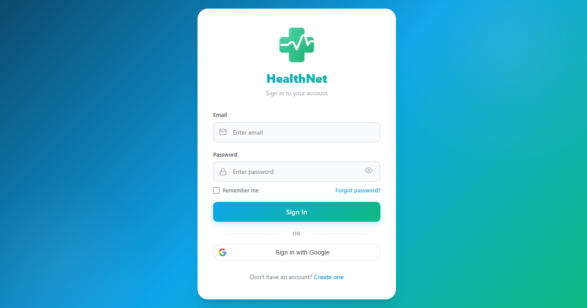
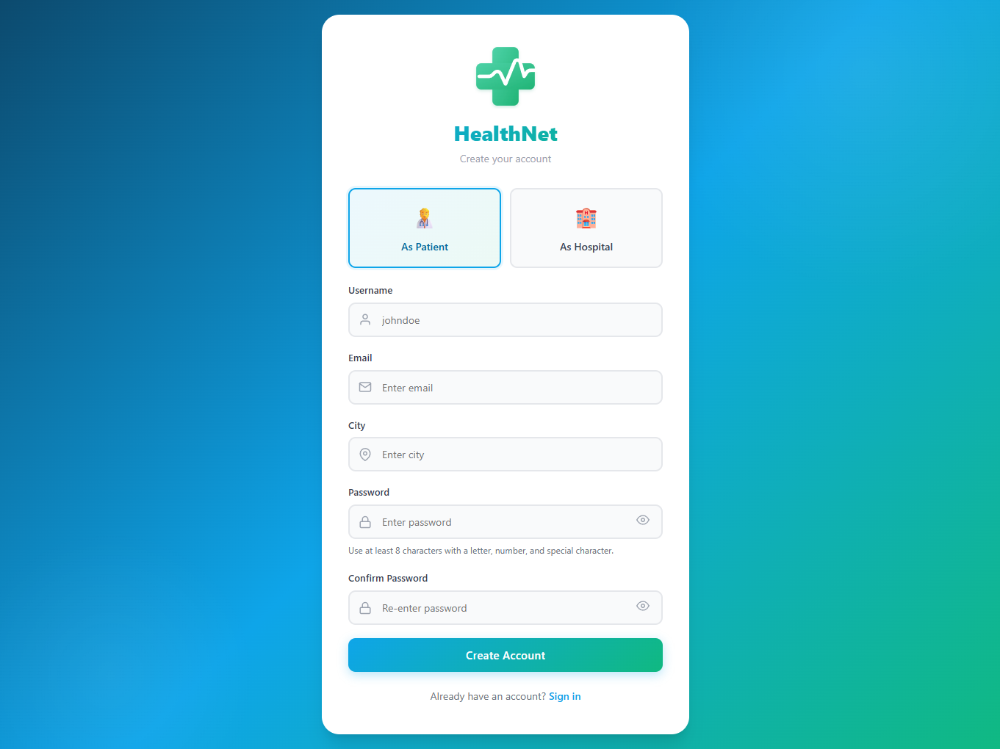
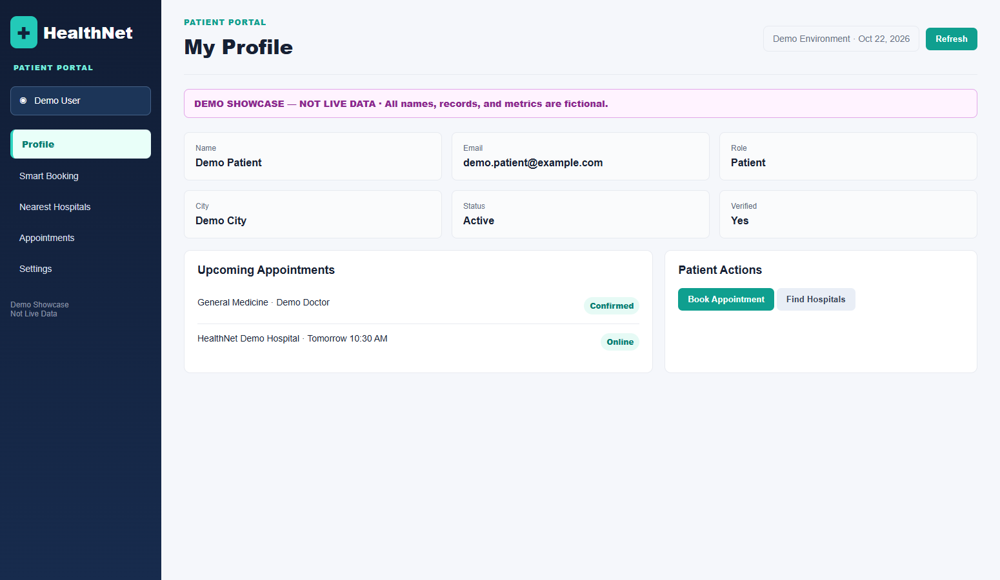
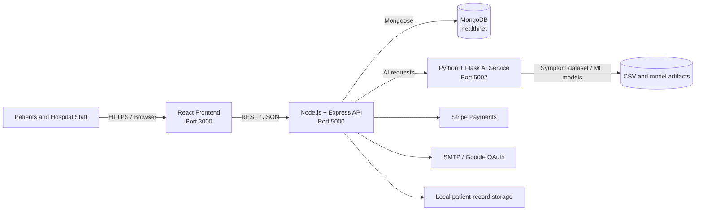

# HealthNet

<h1 align="center">HealthNet Healthcare Management Platform</h1>

<p align="center">
  A full-stack hospital resource, patient workflow, and AI-assisted healthcare management system.
</p>

<p align="center">
  
  
  
  
</p>

## Overview

HealthNet connects patients, doctors, receptionists, hospital administrators, and system administrators through one role-aware platform. It combines secure authentication, hospital operations, appointment workflows, patient records, department resources, AI-assisted symptom analysis, hospital discovery, and payment processing.

## Project Description

HealthNet is a modular healthcare operations platform designed to coordinate clinical, administrative, and patient-facing workflows in a hospital environment. The React frontend provides role-specific interfaces, the Node.js/Express API exposes authenticated business operations, MongoDB stores operational records, and the Flask service provides AI-assisted symptom and disease analysis.

The platform is organized around **five primary stakeholder groups**:

| Stakeholder | Responsibilities and supported workflows |
| --- | --- |
| Patients | Register, authenticate, manage profiles, discover hospitals, request appointments, review diagnoses/prescriptions, and use supported payment flows |
| Doctors | Review schedules, manage appointments and queues, access authorized patient information, record diagnoses, and manage prescriptions |
| Receptionists | Register and coordinate patient visits, manage queues, schedule appointments, and support front-desk hospital operations |
| Hospital administrators | Manage hospital details, departments, staff, schedules, resources, reports, and operational optimization |
| System administrators | Manage platform-wide hospitals, users, staff, oversight workflows, audit information, and administration |

These five groups represent the application roles implemented in the current frontend route guards and backend authentication flows. External stakeholders such as insurers, pharmacies, laboratories, emergency services, and government health systems are not currently modeled as dedicated application roles.

## Highlights

- Role-based authentication for patients, hospital administrators, doctors, receptionists, and system administrators.
- JWT-protected API access with OTP verification and Google Sign-In support.
- Patient registration, profiles, appointments, prescriptions, diagnoses, and medical records.
- Doctor schedules, queue management, appointment workflows, and receptionist operations.
- Hospital and department administration, staff management, reports, and audit logging.
- Live department resource tracking, validation, and optimization workflows.
- AI-powered symptom analysis and disease prediction through a dedicated Flask service.
- Nearest-hospital discovery and hospital resource lookup.
- Stripe payment integration for supported patient payment flows.
- Responsive React dashboards with reusable components and toast-based notifications.

## Scope and Current Limitations

The repository contains the core application source, configuration templates, startup tooling, documentation, and UI screenshots. The following items are intentionally excluded from GitHub or require environment-specific setup:

| Item | Status and reason |
| --- | --- |
| `backend/src/Final_Augmented_dataset_Diseases_and_Symptoms.csv` | Excluded because it is approximately 182 MB and exceeds GitHub's 100 MB individual-file limit; request it by email as described below |
| Generated `.pkl` model artifacts | Excluded as generated/local ML artifacts; regenerate them using the project training workflow when required |
| `.env` files | Excluded because they can contain database credentials, JWT secrets, OAuth values, SMTP passwords, payment keys, and AI API keys |
| `node_modules`, Python environments, build output, caches, and logs | Excluded because they are machine-generated and restored or recreated locally |
| Patient-record storage and local exports | Excluded because they may contain private or sensitive healthcare information |
| MongoDB | Required separately; use a local MongoDB instance or a configured MongoDB Atlas deployment |
| Google OAuth, SMTP, Stripe, and Anthropic services | Optional integrations that require valid project-specific credentials and provider configuration |
| Production deployment infrastructure | Not included as a finalized production deployment; validate security, secrets, networking, backups, monitoring, and compliance before deployment |
| Formal healthcare compliance certification | Not claimed by this repository; deployers must assess applicable privacy, security, retention, and regulatory requirements |

The application should be treated as a development and integration project until authentication, authorization, data protection, integrations, backups, monitoring, and production deployment controls have been independently validated.

## Product Screenshots

### Login

<p align="center">
  
</p>

### Registration

<p align="center">
  
</p>

> Screenshots are captured from the local React application and stored in [`docs/images/`](docs/images/).

## Portal Showcase

The following role-based portal images are fictional UI mockups created for documentation and presentation. Their navigation, tabs, metrics, and workflow panels are based on the corresponding React portal structures. They are clearly labeled **Demo Showcase — Not Live Data** and do not represent authenticated production sessions or real patient information.

### Patient Portal


### Doctor Portal


### Receptionist Portal



### Hospital Administrator Portal


### System Administrator Portal


## System Architecture



### Request flow

1. The browser loads the React single-page application.
2. React sends `/api` requests through the development proxy to Express.
3. Express validates authentication tokens and routes requests by domain.
4. Mongoose persists users, hospitals, appointments, records, resources, and operational data in MongoDB.
5. AI requests are handled by the Flask service and its symptom-matching/ML pipeline.

## Repository Structure

```text
HealthNet/
├── backend/
│   ├── server.js                 # Express entry point and service bootstrap
│   ├── src/
│   │   ├── app.py               # Flask AI service
│   │   ├── config/              # Environment and database configuration
│   │   ├── controllers/         # Domain controller logic
│   │   ├── middleware/           # Authentication and request middleware
│   │   ├── models/               # Mongoose schemas
│   │   ├── routes/               # REST API route modules
│   │   ├── utils/                # Bootstrap, mail, and shared utilities
│   │   └── ai/                   # AI/ML requirements and support files
│   ├── storage/                  # Patient-record and application storage
│   ├── scripts/                  # Dataset and seed utilities
│   ├── .env.example              # Backend configuration template
│   └── package.json
├── frontend/
│   ├── src/
│   │   ├── components/           # Reusable interface components
│   │   ├── pages/                # Authentication and role dashboards
│   │   ├── services/             # Axios API client
│   │   ├── styles/               # Global and feature styles
│   │   ├── hooks/                # React hooks
│   │   └── utils/                # Auth storage and helpers
│   ├── public/                   # Static assets and app metadata
│   ├── .env                      # Local frontend configuration
│   └── package.json
├── docs/images/                  # README screenshots
├── .conda/                       # Project Python environment
└── start.ps1                     # Windows startup helper
```

## Main Frontend Routes

| Route | Purpose |
| --- | --- |
| `/login` | User sign-in |
| `/register` | Patient or hospital registration |
| `/verify-otp` | OTP verification |
| `/forgot-password` | Password recovery |
| `/dashboard` | Hospital administrator dashboard |
| `/doctor/dashboard` | Doctor dashboard |
| `/receptionist/dashboard` | Receptionist dashboard |
| `/patient/profile` | Patient profile and workflow |
| `/admin` | System administrator dashboard |
| `/nearest-hospitals` | Hospital discovery |

## Backend Domains

| API area | Route module |
| --- | --- |
| Authentication | `backend/src/routes/auth.js` |
| System administration | `backend/src/routes/admin.js` |
| Hospital administration | `backend/src/routes/hospitalAdmin.js` |
| Doctor operations | `backend/src/routes/doctorDashboard.js` |
| Receptionist operations | `backend/src/routes/receptionist.js` |
| Patient workflows | `backend/src/routes/patient.js` |
| AI integration | `backend/src/routes/ai.js` |
| Payments | `backend/src/routes/payment.js` |
| Department resources | `backend/src/routes/departmentResourcesRoute.js` |

## Prerequisites

- Windows 10/11
- Node.js 18 or later and npm
- MongoDB running locally on port `27017`, or a configured MongoDB URI
- Python 3.12 environment for the Flask AI service
- Git, if cloning the project

## Installation

From the project root:

```powershell
cd D:\HealthNet1\HealthNet\HealthNet

cd backend
npm install

cd ..\frontend
npm install
```

The project includes a Python environment at `.conda`. Install or refresh its dependencies with:

```powershell
D:\HealthNet1\HealthNet\HealthNet\.conda\python.exe -m pip install -r D:\HealthNet1\HealthNet\HealthNet\backend\src\requirements.txt
```

## Configuration

1. Copy `backend/.env.example` to `backend/.env`.
2. Set `MONGO_URI`, `JWT_SECRET_KEY`, and any optional mail, Google, Stripe, or Anthropic values.
3. Keep frontend values in `frontend/.env`.
4. Never commit real credentials, API keys, SMTP passwords, or production database URLs.

The default local service configuration is:

| Service | URL / port |
| --- | --- |
| React frontend | `http://localhost:3000` |
| Node/Express API | `http://localhost:5000` |
| Node API health check | `http://localhost:5000/api/health` |
| Flask AI API | `http://localhost:5002` |
| MongoDB | `mongodb://localhost:27017/healthnet` |

## Run on Windows

### Option A: Startup helper

From the project root:

```powershell
.\start.ps1
```

To also attempt an ngrok tunnel:

```powershell
.\start.ps1 -WithNgrok
```

### Option B: Run each service explicitly

Terminal 1 — Node API:

```powershell
cd D:\HealthNet1\HealthNet\HealthNet\backend
npm start
```

Terminal 2 — Flask AI service:

```powershell
cd D:\HealthNet1\HealthNet\HealthNet\backend
D:\HealthNet1\HealthNet\HealthNet\.conda\python.exe src\app.py
```

Terminal 3 — React frontend:

```powershell
cd D:\HealthNet1\HealthNet\HealthNet\frontend
npm start
```

Open [http://localhost:3000](http://localhost:3000) in a browser.

## Verification

Check the Node API:

```powershell
Invoke-WebRequest http://localhost:5000/api/health
```

Check the AI symptom endpoint:

```powershell
Invoke-WebRequest http://localhost:5002/api/symptoms
```

## Development Commands

### Backend

```powershell
npm start
npm run dev
npm run seed:doctor-appointments
npm run seed:bulk-hospitals
npm run seed:import-patient-record-files
```

### Frontend

```powershell
npm start
npm run build
npm run pages:dev
```

## Security and Operations Notes

- Use a strong, unique `JWT_SECRET_KEY` outside local development.
- Restrict CORS origins before production deployment.
- Use HTTPS for production authentication and payment flows.
- Store secrets in a managed secret store rather than `.env` files in deployed environments.
- Configure SMTP, Google OAuth redirect origins, and Stripe keys for the target environment.
- Back up MongoDB and patient-record storage according to the applicable healthcare data policy.

## Contact and Discussion

For project discussions, technical questions, collaboration, or support, contact:

**Arsal Arain**  
Email: [arsalarain72@gmail.com](mailto:arsalarain72@gmail.com)

### Requesting the symptom dataset

The large symptom dataset is not included in this GitHub repository because GitHub limits individual files to 100 MB. The excluded file is:

```text
backend/src/Final_Augmented_dataset_Diseases_and_Symptoms.csv
```

If you need this file for authorized development, research, or local setup, email [arsalarain72@gmail.com](mailto:arsalarain72@gmail.com) with the subject **HealthNet dataset request**.

## Technology Stack

| Layer | Technologies |
| --- | --- |
| Frontend | React 18, React Router, Axios, Framer Motion, React Icons, React Toastify |
| API | Node.js, Express, Mongoose, JWT, bcryptjs, Multer |
| AI service | Python, Flask, Flask-CORS, Pandas, NumPy, scikit-learn, RapidFuzz, Anthropic |
| Data | MongoDB, CSV symptom dataset, local NDJSON patient-record storage |
| Integrations | Google OAuth, Stripe, SMTP, optional ngrok |

## License

This project is maintained as a HealthNet application repository. Add the project's chosen license and contribution policy before public distribution.
